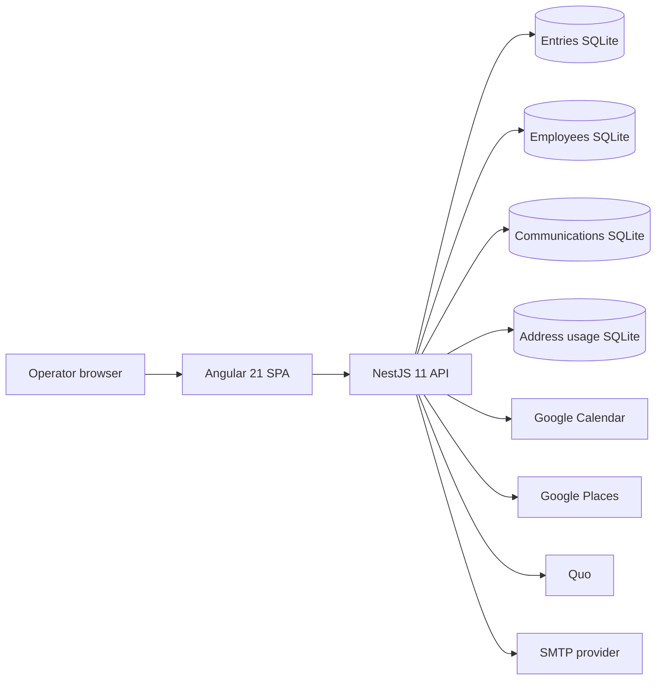
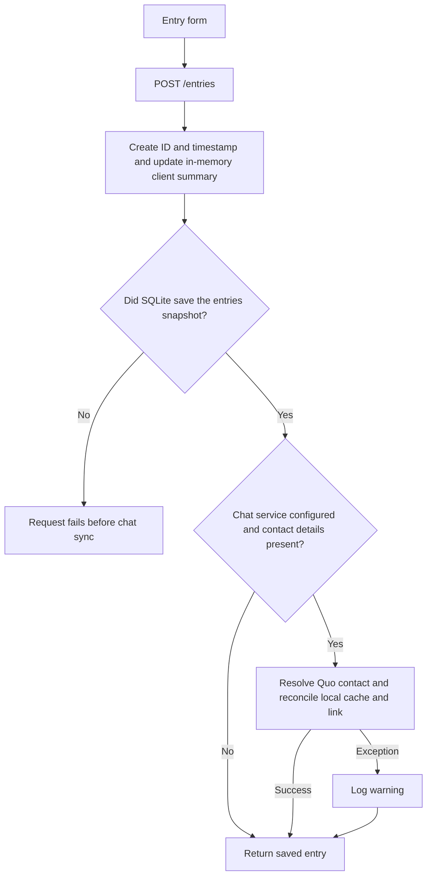

# EcoCut System Design Guide

Status: observed implementation, 2026-10-02. This describes the code in the repository, not a target deployment.

## Boundaries and data

- Angular routes are defined in `src/app/core/app.routes.ts`; feature code is under `src/app/features/`, and shared domain/API clients are under `src/app/shared/`.
- Nest starts from `server/src/main.ts`; its entries, employees, addresses, calendar, and communications modules serve the live UI.
- Four `better-sqlite3` repositories persist to separate local files in WAL mode. Entries and some other modules store JSON payloads or whole snapshots. There is no repository-wide transaction across those databases.
- The API calls Google Calendar, Google Places, Quo, and SMTP from server-side services. Configuration is supplied with environment variables; `.env.example` is only a template.
- Review data transfer, credentials, quota, and failure behavior for each integration before launch. See the [provider boundary review](../provider-boundaries.md).
- The browser suite in `e2e/` uses temporary SQLite files and mocks external provider calls. It is an application-flow check, not proof of a live provider connection.

## Production constraints visible in code

1. `server/src/main.ts` creates a Nest app and listens on a port; it does not establish operator authentication. Employee endpoints accept a client-supplied `x-operator-role` header. Treat this as a demo role switch, not production authorization. Do not expose write endpoints to the public until identity and server-side permissions are implemented and verified.
2. SQLite files need persistent storage, a single-writer deployment plan, verified online backups, and tested restore. Ephemeral service filesystems cannot be the source of truth.
3. Seed employee data and default database paths need an explicit environment policy before production. The `.env.example` template now documents `EMPLOYEES_DB_PATH`; runtime path handling still needs verification.
4. There is no declared production deployment, migration runner, global request validation policy, centralized telemetry, or operations runbook in this repository yet.
5. CI checks frontend, server, and browser tests, but deployment and post-deploy verification have not been automated.

## Next architecture views

### How saving an entry works today

The entries service updates its in-memory records before the persistence call. A failed save can leave memory ahead of durable storage. After a successful save, a provider failure is caught so the operator can still receive the entry. Contact sync can write a provider contact. The read-only messaging requirement concerns customer delivery, and contact sync needs its own decision.

Source paths: [entries controller](../../server/src/entries/entries.controller.ts), [entries service](../../server/src/entries/entries.service.ts), and [chat service](../../server/src/communications/chats/communications-chats.service.ts). This diagram follows source code.

Add a target container/deployment view after hosting and database decisions are accepted. Add a data-flow and trust-boundary diagram before auth and webhook hardening. Keep feature-level diagrams only where they clarify a complex workflow.
